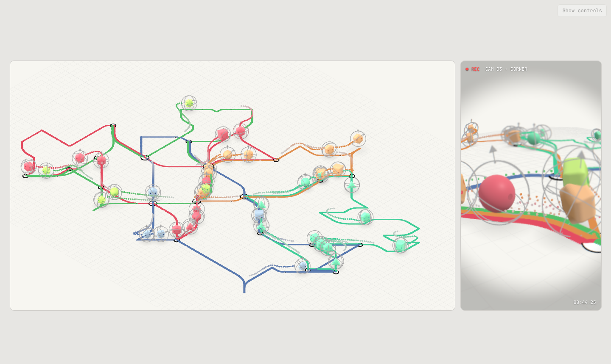
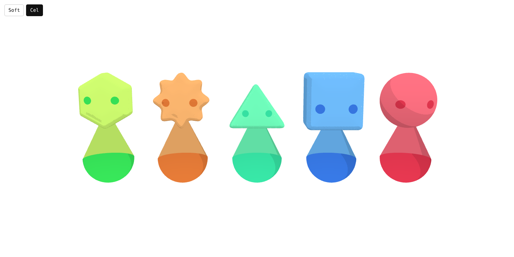
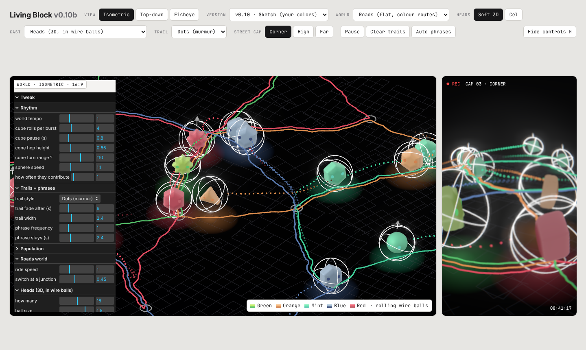

# Healthy Living Simulation

A living, breathing map of little characters doing research. Each character is a soft 3D head riding inside a rolling wire ball. They travel colour-coded lines across a city that keeps growing, swap lines when they meet, and leave fading dot trails behind them.

The project started from [murmur.living](https://murmur.living): a city block where every shape follows its own movement rules and leaves a trail. The theme is health and cancer research. Each character is an "agent" doing work ("PULLING 3 NEW TRIALS"), and the map shows that work as motion.

The repo holds two prototypes and a set of 3D characters:

| Folder | What it is | Tech |
| --- | --- | --- |
| [`playground/`](playground/) | **The Living Block playground.** One HTML file with every world, cast, trail and camera as a switchable option. This is the main sandbox. | Plain HTML + three.js r160 (from a CDN) + lil-gui |
| [`assets/3d/`](assets/3d/) | **Cone guys:** the five characters as 3D `.glb` models, plus a small viewer. | glTF 2.0 |
| [`scroll-pilot/`](scroll-pilot/) | **The scroll pilot.** A five-step scroll story: the hero head, then letter-shaped paths, then an aerial view, then the type fills in. | Next.js 15, React 19, three.js r170, opentype.js |



---

## Quick start

### Playground (no install)

The playground is a single self-contained file. Open it in a browser:

```bash
open playground/index.html          # macOS
# or serve it, which some browsers need for ES modules:
npx serve playground                # then visit the printed URL
```

It loads three.js and lil-gui from jsDelivr, so the first load needs an internet connection.

### Scroll pilot

```bash
cd scroll-pilot
# 1. Copy the two KMR Melange Grotesk .otf files into public/fonts/ (see public/fonts/README.md)
npm install
npm run dev                         # http://localhost:3000
```

`npm run build` writes a static site to `scroll-pilot/out/`.

---

## The playground in depth

### Layout

- **World view (16:9, left):** an orthographic camera that eases between **Isometric** and **Top-down**. Scroll the mouse wheel to zoom. **Fisheye** bends the frame like a wide lens, with a vignette and a hint of colour fringe.
- **Street cam (9:16, right):** a "CCTV" perspective camera down at street level, with a fisheye warp and a running clock. It has three presets: **Corner**, **High** and **Far**.
- **Header bar:** the main switches, described below.
- **Tweak panel (lil-gui):** every tuning number. Press **H** or use **Hide controls** to get a clean frame for screenshots.

Your choices for world, cast, head look and trail are saved in `localStorage`, so the page reopens the way you left it.

### Header controls

| Control | Options | What it does |
| --- | --- | --- |
| View | Isometric · Top-down · Fisheye | Camera angle and lens of the world view |
| Version | Sketch · Night · Hero | Colour and lighting presets (see below) |
| World | **Subway map** · Roads · Block | What the ground is made of |
| Heads | **Soft 3D** · Cel | Glossy plastic heads, or toon-shaded with an ink outline |
| Cast | **Heads** · Blocks · Orbits | Which characters live in the world (Blocks and Orbits are earlier casts, saved for later) |
| Trail | Lines + nodes · **Dots** · Stamps · Off | How the trails behind the characters are drawn |
| Street cam | Corner · High · Far | Framing of the right-hand camera |
| Pause / Clear trails / Auto phrases | | Freeze the sim, wipe trails, or let characters pop up random status phrases (hovering a character always shows what it's doing) |

### Versions (colour presets)

- **Sketch:** light greys and the team's head colours. This is the default.
- **Night (murmur-ish):** a dark city lit from within. The ground is a low-poly triangle mesh, building windows are an even square grid in the palette only, and the characters glow softly.
- **Hero:** a clean white background with stamp-style trails, built for a hero image.

### Worlds

#### Subway map (default)
This world follows subway-map rules:
- Lines only run at **0°, 45° or 90°**.
- Every bend is a tight rounded corner. There are no loops and no free curves.
- Lines that share a stretch run **side by side as one ribbon of colours**, then split off again.
- Stations where lines meet are white discs with a black ring. Smaller stops along each line are black dots with a white rim.

#### Roads
The same network drawn as flat, hand-jagged city roads over a patchwork of faint street grids, like a traffic map. Busy corridors read thick because several coloured routes bundle together.

#### Block
The original 3D city block of towers, sidewalks and streets. Characters wander freely between the buildings.

#### The map keeps growing (Subway and Roads)
The network is never a finished square. It is live state that keeps expanding:

1. Every few seconds a stretch of line near the **outer edge** is chosen. Edges far from the centre are more likely, and lines with fewer stops get a fair turn.
2. A **new stop** is placed beyond it. In the subway world it is pushed out along a 45° heading and snapped to the half-unit grid.
3. A stroke in that line's colour **draws itself** out to the new stop and back in, and the station pops in.
4. About half the time a **second nearby line bends over to share the new stop**, so the lines keep converging out at the frontier too.
5. The street grid spreads tile by tile to cover the new ground.
6. A **new head hops on** at the new stop and rides off.
7. The camera **eases out and re-centres** so the whole network stays in frame.

Once the map reaches its stop limit it keeps evolving anyway. Lines reroute through nearby stops they didn't serve before, or drop a detour.

Each stretch of line is generated once and cached, so existing streets never change shape when the map grows. Riders are moved onto the rebuilt copy of their route at the nearest point, so nobody jumps.

**Tweak → Roads world:**

| Setting | Default | Meaning |
| --- | --- | --- |
| ride speed | 1 | How fast heads travel along lines |
| switch at a junction | 0.45 | Chance a head changes line (and colour) at a shared station |
| map keeps growing | on | Turn growth on or off |
| grow every (s) | 4 | Seconds between growth steps |
| max stops | 60 | Stop count after which the map only reroutes |
| max heads | 40 | Cap on characters, including the ones that hop on |
| camera eases out | on | Let the camera follow the growth |
| start the map over | | Reset the network to its starting 14 stops |

### The cast

#### Heads (default)
These are the team's soft 3D heads, ported from `softHead()` in the d1 page of the healthier repo (`public/d1/yii.js`). There are five shapes (hexagon, star, triangle, square, circle). Each head is a light moulded colour with darker dot eyes of the same hue:

| Colour | Head | Eyes / line |
| --- | --- | --- |
| Green | `#c5ee70` | `#55c06a` |
| Orange | `#f6bb80` | `#d0814f` / line `#e0904f` |
| Mint | `#7aeeb8` | `#5fc8b3` / line `#3fcf9a` |
| Blue | `#a8c1d6` | `#3a4a75` / line `#5b7bb0` |
| Red | `#ee6878` | `#bb5f68` / line `#e44d62` |

Each head sits in the middle of a **wire "hamster ball"**:
- The ball has an outline plus rolling middle lines that show the ball turning as it moves.
- The head stays upright and looks around.
- Balls sometimes float up off the ground.
- About half carry a small stem with an arrow on top.
- The trail comes out of the **back centre** of the ball.

In the Subway and Roads worlds, heads ride lines one-way like trains. They keep a gap from whoever is ahead and never wait more than a moment. At shared stations they sometimes switch lines and take on the new line's colour, with a little pop.

**Soft 3D** uses physical materials with a room-environment reflection. **Cel** uses toon shading in hard steps with a black ink hull.

**Tweak → Heads:** how many, ball size, face toward viewer, wobble + nod, middle lines on the ball, how often they float, share with an arrow, head look.

#### Blocks (saved)
These are cubes that roll, hop and slide, cones that hop and pivot, and spheres with bump physics. Their pace follows their mood. With **hill + pile** on, they sometimes carry a piece up the central hill's spiral paths and add it to a growing pile.

#### Orbits (saved)
These are heads in wire bubbles with a ghosted wire skeleton and a stem topped by a coloured ball on a spring. They steer fluidly in any direction with a follow-the-leader rope trail.

### Trails

All trails are a **rope**: a chain of points dragged behind each character that fades over time.

- **Dots (murmur):** evenly spaced dots that fade away. This is the default for heads.
- **Lines + nodes:** a fat line with node dots.
- **Stamps:** the character's outline printed along its path.
- **Off:** no trails. This choice stays when you switch versions.

**Tweak → Trails + phrases:** trail style, fade time, width, phrase frequency, and how long phrases stay up.

### How the code is organised

`playground/index.html` is one file, top to bottom:

1. **Settings (`S`) and presets (`PRESETS`).** All tunables live in `S`. Each version is a preset of colours.
2. **City:** ground, streets, buildings, the night lights and the optional hill.
3. **Trails:** the shared rope/trail renderer (fat lines, dot points, stamps).
4. **Characters:** an `Agent` base class plus `Cube`, `Cone`, `Sphere` and `Orb`. `Orb` covers both the bubble heads and the 3D heads in wire balls.
5. **Heads:** `HEAD_CHARS` (colours), `HEAD_ROSTER` (shape and colour per character), the soft and cel material builders.
6. **Roads and Subway networks:**
   - `ROUTE_DEFS` and `HUB_XZ` are the starting lines and stops.
   - `buildNet`, `rebuildNet` and `edgePath` build the lines, bundles and stations.
   - `routeAt` samples a position along a route.
   - `Orb.prototype.roadStep` is the riding logic.
7. **Growth:** `planGrowth` picks where to grow, `growStep` starts the stroke animation, `growTick` runs each frame (growth timer, camera fit), and `hopOn` spawns a new rider.
8. **Cameras and rendering:** the orthographic world camera, the perspective street cam, the fisheye shader passes, and the `frame()` loop.
9. **UI:** the header handlers and the lil-gui folders.

`window.__lb` exposes a few hooks for testing in the console. For example, `__lb.step(300)` fast-forwards 10 seconds and `__lb.grow()` forces a growth step.

---

## The scroll pilot in depth

A single scroll-snapped page with five steps, each about one screen tall:


0. **Hero:** the green head floats in its wire ball under the d1 headline, which rises word by word with the button fading in after, as on the d1 page.
1. **Pull back:** the camera pulls back into a tight isometric view on the **r** of "research". Thirty-eight characters roll along paths that are secretly letter outlines, but the view is too close to read them.
2. **Track:** the camera tracks along the line from the **r** in "research" to the **r** in "your". This move is scrubbed by scroll over five screens, so it goes as slowly as you scroll.
3. **Aerial:** the camera zooms out to straight overhead. The balls become coloured dots and the paths read as *"A world of research on your case."*
4. **Fill:** the type fills in.

| File | Role |
| --- | --- |
| `components/ScrollPilot.jsx` | The page, headline animation, and mapping scroll position to a 0–4 progress value |
| `lib/scene.js` | three.js scene: camera keyframes, characters, paths, dots, fill. Tweak `SETTINGS` at the top (count, ball size, speed, iso zoom, colours). |
| `lib/letters.js` | Sets the sentence in KMR Melange Grotesk with opentype.js and turns each glyph into closed paths the characters can follow |
| `lib/heads.js` | The soft heads, ported from the healthier d1 page |
| `relativize.py` | Turns `out/` into a copy that runs from any folder (used for the Claude preview link) |

**Fonts:** KMR Melange Grotesk is a licensed typeface, so it is not committed. Copy the two `.otf` files into `scroll-pilot/public/fonts/` as described in [that folder's README](scroll-pilot/public/fonts/README.md).

---

## Cone guys (3D models)



Five ready-made 3D characters live in [`assets/3d/`](assets/3d/) as `.glb` files. Each is a soft head sitting on a cone that stands on a rounded bowl, so it can rock like a weeble. There is one head shape per colour:

| File | Head | Light (head, cone) | Dark (eyes, bowl) |
| --- | --- | --- | --- |
| `cone-hexagon-green.glb` | Hexagon | `#cefc6f` | `#36e057` |
| `cone-star-orange.glb` | Star | `#fcb66f` | `#e07836` |
| `cone-triangle-mint.glb` | Triangle | `#6ffcbb` | `#36e0a2` |
| `cone-square-blue.glb` | Square | `#6fbcfc` | `#3676e0` |
| `cone-circle-red.glb` | Circle | `#fc6f80` | `#e0364e` |
| `cone-guys-all.glb` | All five in a row | | |

**Scale and orientation.** One unit = the bowl's diameter (the bowl radius is 0.5). The ground is at `y = 0`, the figures stand about 2.1 units tall, and they face `+z`.

**Mesh names.** Each figure is a group named `cone-<shape>-<colour>` with four parts: `bowl`, `cone`, `head` (made of `head-shell` plus two `eye` meshes). Materials are named `<colour>-light` and `<colour>-dark`, so you can recolour them in Blender, Spline or code.

**Getting the cel look.** glTF only stores base colours (PBR standard materials). For the flat cel style, swap each material for a toon material in the same colour. [`assets/3d/viewer.html`](assets/3d/viewer.html) shows how. Serve the folder (`npx serve assets/3d`) and open the viewer, then use the Soft / Cel buttons and drag to orbit.

```js
import { GLTFLoader } from 'three/addons/loaders/GLTFLoader.js';
new GLTFLoader().load('cone-star-orange.glb', (gltf) => {
  gltf.scene.traverse((m) => { if (m.isMesh) m.material = new THREE.MeshToonMaterial({ color: m.material.color }); });
  scene.add(gltf.scene);
});
```

**Rebuilding them.** [`tools/export-cone-guys-glb.cjs`](tools/export-cone-guys-glb.cjs) regenerates every `.glb` from the head geometry in the playground and the palette in `tools/cone-guy-palette.json`. It needs Node, Playwright and a local copy of `three@0.160.0` in `tools/node_modules`.

---

## Gallery

| | |
| --- | --- |
|  Subway world, close up |  Roads world after growing |
|  Roads world, Night version |  Soft 3D vs Cel heads |

## Roadmap

- **Growth-patterns world:** heads hop out of a hole in the ground and grow organic, branching paths as they go, like roots or coral.
- **The real build:** move the chosen pieces into Next.js with React Three Fiber, drei, postprocessing, Leva and Zustand, deployed on Vercel. This waits until the direction is approved.

## Credits

Concept and art direction by Will. Inspired by [murmur.living](https://murmur.living). Head geometry ported from the team's healthier d1 page. Built with [three.js](https://threejs.org), [lil-gui](https://lil-gui.georgealways.com), [Next.js](https://nextjs.org) and [opentype.js](https://opentype.js.org).
