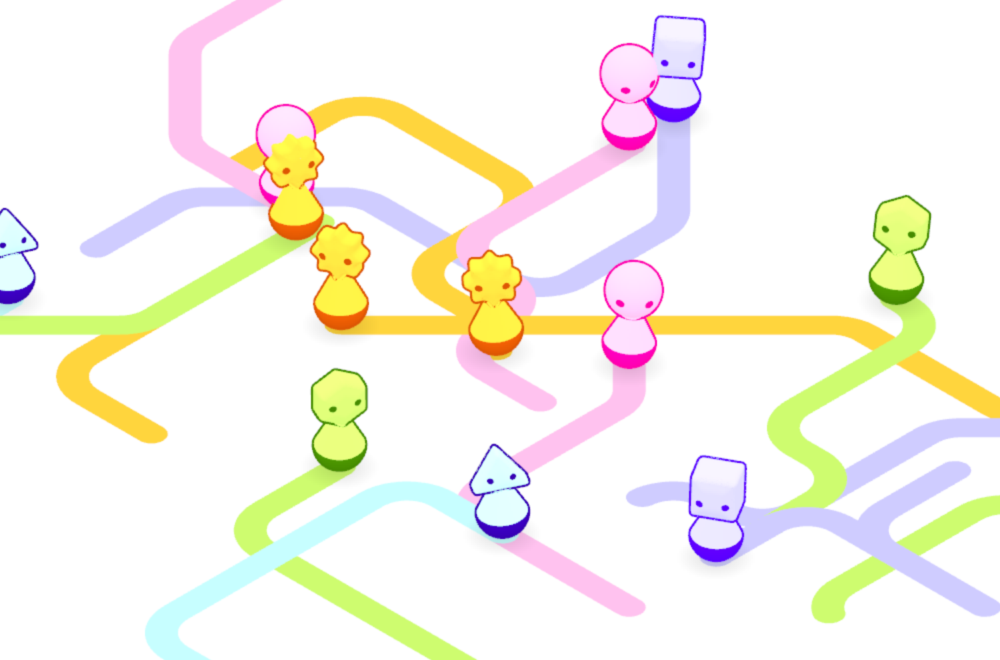
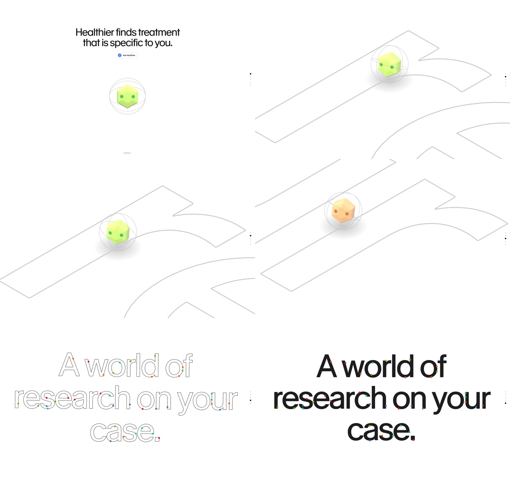
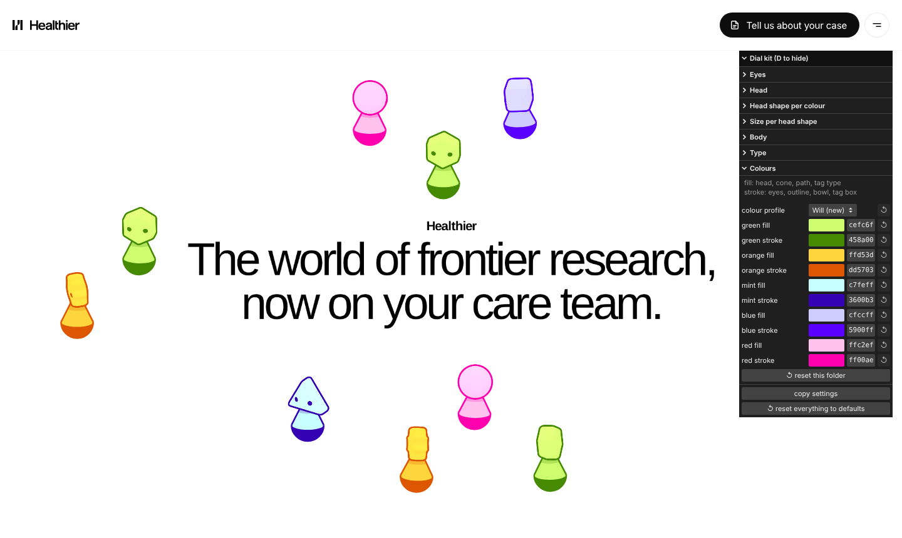
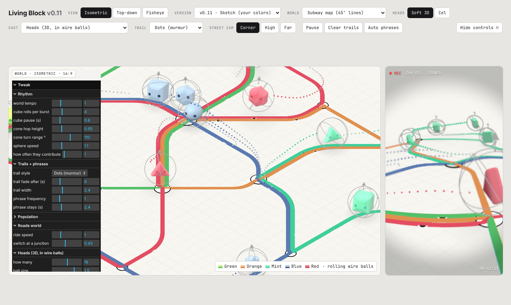
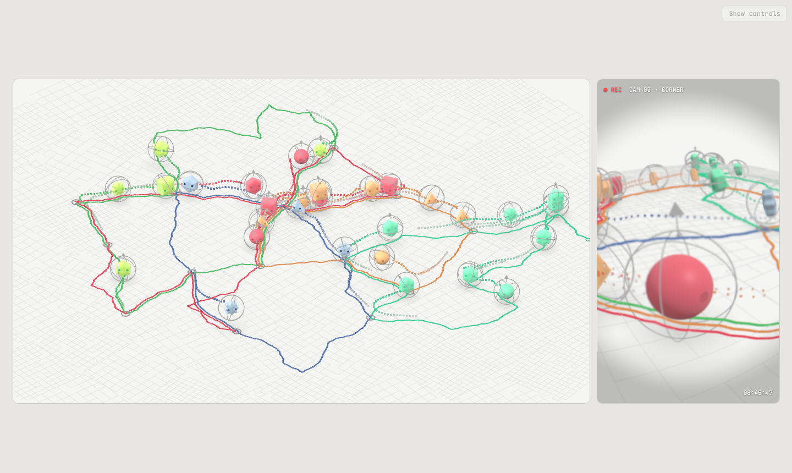
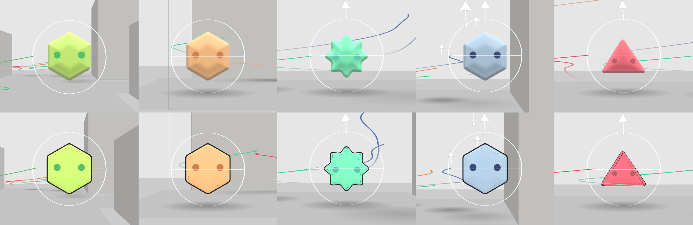
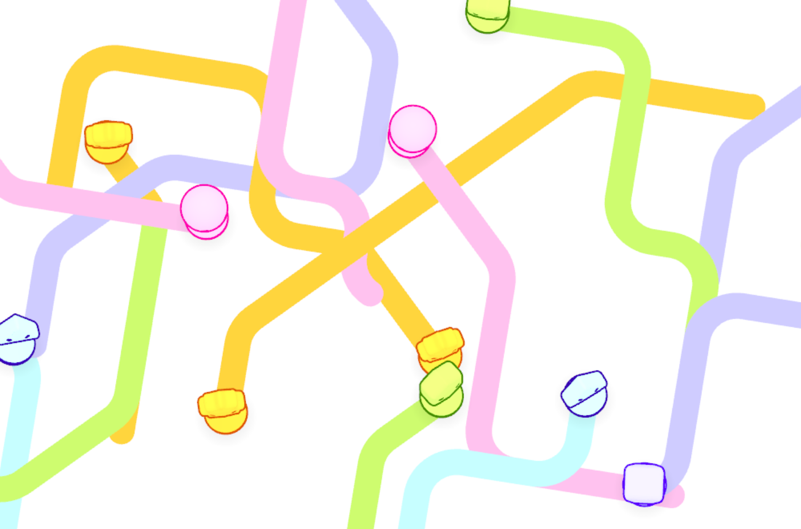
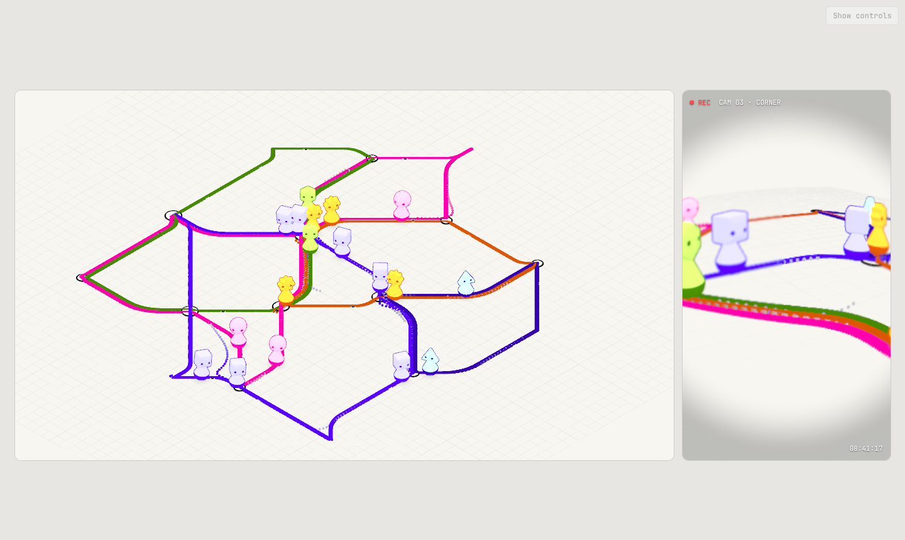
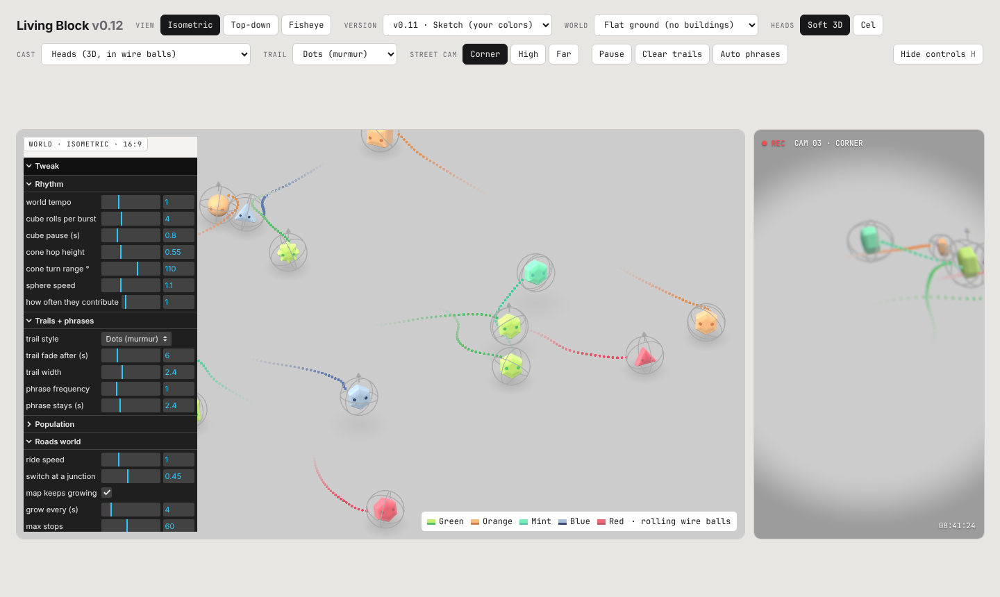

# Healthy Living Simulation

A living, breathing map of little characters doing research. The main characters are the **cone guys**: soft cel-shaded heads on a cone that rocks on a rounded bowl. They plan routes across a light grid — or roam free on the plain floor — and lay down coloured ribbons as they go.

The project started from [murmur.living](https://murmur.living): a city block where every shape follows its own movement rules and leaves a trail. The theme is health and cancer research. Each character is an "agent" doing work ("PULLING 3 NEW TRIALS"), and the map shows that work as motion.

The repo holds the prototypes, an archive and a set of 3D characters. [`index.html`](index.html) at the root is a browseable index of all of them:

| Folder | What it is | Tech |
| --- | --- | --- |
| [`playground/`](playground/) | **The Living Block playground.** One HTML file with both flat grounds, every trail and camera as a switchable option; the cast is the cone guys. This is the main sandbox. | Plain HTML + three.js r160 (from a CDN) + lil-gui |
| [`hero-sim/`](hero-sim/) | **The Healthier hero sim.** The website hero: cone guys make paths around the headline, with a frosted nav and a dial kit for every look setting. | Plain HTML, 2D canvas + three.js r160 for the heads, lil-gui |
| [`assets/3d/`](assets/3d/) | **Cone guys:** the five characters as 3D `.glb` models, plus a small viewer. | glTF 2.0 |
| [`scroll-pilot/`](scroll-pilot/) | **The scroll pilot.** A five-step scroll story: the hero head, then letter-shaped paths, then an aerial view, then the type fills in. | Next.js 15, React 19, three.js r170, opentype.js |
| [`archive/v011/`](archive/v011/) | **Playground v0.11, frozen.** A verbatim copy of `playground/index.html` as committed in `858593e`, kept for comparison. | Same as the playground |



---

## Quick start

Start at the root [`index.html`](index.html): a browseable index of every study with screenshot plates and direct links. Serve the repo root so the ES-module pages and the generated previews work:

```bash
python3 -m http.server 8040        # then open http://localhost:8040/
```

### Playground (no install)

The playground is a single self-contained file. Open it in a browser:

```bash
open playground/index.html          # macOS
# or serve it, which some browsers need for ES modules:
npx serve playground                # then visit the printed URL
```

It loads three.js and lil-gui from jsDelivr, so the first load needs an internet connection. Append `?preset=sketch`, `?preset=night` or `?preset=hero` to open a specific version (v0.12, v0.12b, v0.12c), and `?world=flat-grid` or `?world=flat` to pick the ground (the light grid is the default).

### Playground archive (historical source)

[`archive/v011/index.html`](archive/v011/index.html) is the playground frozen at v0.11 — a verbatim copy of `playground/index.html` as committed in `858593e` ("Add Living Block playground and scroll pilot with README"), before the cone-guys cast and flat ground world existed. The only differences are a provenance comment and the same `?preset=` deep links; the index links each archived version directly.

### Scroll pilot

The live preview is a generated static export in `scroll-pilot/preview/` — git-ignored, so a fresh checkout prepares it once:

```bash
cd scroll-pilot
# 1. Copy the two licensed KMR Melange Grotesk .otf files into public/fonts/
#    (see public/fonts/README.md — the font files are not committed)
npm ci
npm run build                            # writes out/
python3 relativize.py out preview        # rewrites out/ -> preview/, runnable from any folder
cd ..
python3 -m http.server 8040              # open http://localhost:8040/scroll-pilot/preview/
```

To hack on it instead, `cd scroll-pilot && npm run dev` serves the app at http://localhost:3000. [`scroll-pilot/index.html`](scroll-pilot/index.html) is a static storyboard + setup page that stays available even before the preview is built, and links to the live export once it exists.

### Hero sim

```bash
npx serve hero-sim                  # then visit the printed URL
```

For the real type, copy the three ABC Diatype `.otf` files into `hero-sim/fonts/` (see the README there) — they are optional; without them the page falls back to system fonts, and the dial kit can also pick Google fonts. Press **D** to show or hide the dial kit.

### What's committed vs. fetched

- **Committed:** all HTML/JS/CSS source, the `.glb` models, screenshots, and the generated `preview/` is *not* committed (git-ignored, like `out/`).
- **Local font files (licensed, not committed):** the two KMR `.otf` files for the scroll pilot (required — they build the letter paths) and the three ABC Diatype `.otf` files for the hero sim (optional — system-font fallback).
- **CDN:** playground, hero sim and the cast viewer pull three.js/lil-gui from jsDelivr at runtime; the scroll pilot bundles its own three.js into the export.

---

## The playground in depth

### Layout

- **Sidebar:** one panel on the left holds every control — screen picker, the active screen's view buttons, version/world selects, sim buttons, and the tweak panel below. Press **H** or use **Hide controls** to get a clean frame for screenshots.

Your choices for screen, world, preset and trail are saved in `localStorage`, so the page reopens the way you left it.

### Sidebar controls

| Control | Options | What it does |
| --- | --- | --- |
| Screen | World · 16:9 · Street cam · 9:16 | Which camera view is shown — only one renders at a time, and only its view buttons appear |
| View (world screen) | Isometric · Top-down · Side · Fisheye | Camera angle and lens of the world view |
| Street cam (street screen) | Corner · High · Far | Framing of the street camera |
| Version | Sketch · Night · Hero | Colour and lighting presets (see below) |
| World | Flat ground · **Light grid** · Flat ground · Plain | The floor: plain, or marked with a light grid the guys route on |
| Pause / Clear trails / Auto phrases | | Freeze the sim, wipe trails, or toggle ambient status phrases (on by default, max two at a time; hovering a character still shows what it's doing) |
| Tweak panel (lil-gui) | | Every tuning number — trail style, rhythm, cone guys, street cam, night light — plus a **Reset to defaults** button at the top |

### Versions (colour presets)

- **Sketch:** light greys and the team's head colours. This is the default.
- **Night (murmur-ish):** a dark scene lit from within. The ground is a faint low-poly triangle mesh on near-black, and the characters glow softly.
- **Hero:** a clean white background with stamp-style trails, built for a hero image.

### Worlds

#### Flat ground · Light grid (default)
One open floor marked with a faint neutral grid. Every cone guy plans a route across the grid before it moves — routes run through the **centres** of the grid squares, in the white space between the lines:

- Routes use long straight legs that are whole numbers of grid cells.
- Every turn is an exact **90°** corner — no diagonals, no rounded fillets.
- Routes never cross themselves, and guys keep a little space from each other's ribbons.
- Spawns snap to grid cell centres inside the floor, and the visible grid lines stay on the cell edges and rebuild if you change the cell size.
- Lines and dots are laid straight along the route, so they keep the same right angles; the ribbon band follows the path exactly.

#### Flat ground · Plain
The same floor with no grid marking. The cone guys keep the older movement options: the **grid routes** knob still works (with the hero sim's rounded corners and occasional diagonals), or turn it off and they roam freely, steering around the edges and each other.

### The cast

#### Cone guys
The characters from the hero sim, in full 3D — the only cast. Each guy is a cel-shaded head on a cone standing on a dark bowl, with one head shape per colour. They use the new default palette:

| Colour | Head shape | Fill (head, cone, ribbon) | Stroke (eyes, bowl, outline) |
| --- | --- | --- | --- |
| Green | Hexagon | `#cefc6f` | `#458a00` |
| Orange | Star | `#ffd53d` | `#dd5703` |
| Mint | Triangle | `#c7feff` | `#3600b3` |
| Blue | Square | `#cfccff` | `#5900ff` |
| Red | Circle | `#ffc2ef` | `#ff00ae` |

- **Weeble body:** the bowl rocks about its centre. The guy leans into speeding up, slowing down and turning, with a small wobble as it goes.
- **Steady head:** the head stays fixed on the neck and only turns left and right, toward where the guy is heading and partly toward the viewer.
- **Outline:** an even ink line in the stroke colour, drawn with a stencil so only the silhouette shows. The head and body each keep their own outline, so the chin is always outlined, and no thin lines show inside the heads.
- **Grid routes:** each guy plans a whole route before it moves. In the light-grid world the legs are whole grid cells with exact 90° corners, snapped to cell centres so the paths run through the squares' white space; in the plain world the hero sim's rounded corners and occasional diagonals apply. Each guy rolls at its own pace — a personal tempo and drifting mood set the base speed, and every route eases toward its own target with the occasional surge, so nobody moves at exactly the same speed for long. The ribbon lingers when the route ends, then lifts away from its start while the guy sets off again.

**Tweak → Cone guys:** how many, size, wobble + nod, eye size, eye spacing, grid routes on/off (plain world only — the light-grid world is always on the grid), grid cell size (rebuilds the grid and respawns), ribbon width, how long ribbons stay.

### Trails

All trails are a **rope**: a chain of points dragged behind each character that fades over time. In the light-grid world the lines and dots instead follow the planned route point for point, so they keep the same right-angle corners as the ribbon.

- **Ribbon (hero sim):** a solid flat band in each guy's fill colour with round ends. It doesn't fade: it lingers, then lifts away from its start. This is the default. Each trail gets a slight hue/saturation/lightness jitter so ribbons vary without transparency (which used to blend badly on corners).
- **Ribbon + line:** the same translucent ribbon, with a thin opaque line in the guy's stronger stroke colour laid exactly on top of it.
- **Dots (murmur):** evenly spaced dots that fade away.
- **Lines + nodes:** a fat line with node dots.
- **Stamps:** the character's outline printed along its path.
- **Mixed (per shape):** each colour/shape gets its own trail kind — lines, dots, stamps, ribbon or ribbon+stamps — so all five kinds show at once. The deal is reshuffled every time the cast repopulates.
- **Off:** no trails. This choice stays when you switch versions.

**Tweak → Trails + phrases:** trail style, fade time, width, phrase frequency, and how long phrases stay up. Ambient status phrases are on by default and capped at two visible at once; hovering a character optionally pins a phrase.

### How the code is organised

`playground/index.html` is one file, top to bottom:

1. **Settings (`S`) and presets (`PRESETS`).** All tunables live in `S`. Each version is a preset of colours.
2. **Scene:** the flat ground plane, the light grid, lights, presets and the night ground mesh.
3. **Trails:** the shared rope/trail renderer (fat lines, dot points, stamps) plus the route-following grid trails.
4. **Characters:** an `Agent` base class plus `ConeGuy`, the only cast. Each guy plans grid routes or roams freely, and always poses through `conePose`.
5. **Heads:** `CONE_PAL`/`CONE_CHARS` (the five colours, shapes and phrases), Will's procedural soft-head geometry (`softHead`, shared with the GLB exporter) and the toon/ink materials.
6. **Grid routes:** `planRoute` picks a route (cardinal legs and exact 90° turns in the light-grid world, rounded corners and occasional diagonals in the plain world), `planPath`/`pathAt` sample it, `gridStep` rolls the guy along it, and `PathRibbon` draws the ribbon.
7. **Cameras and rendering:** the orthographic world camera, the perspective street cam, the bloom/depth-blur/fisheye post passes, and the `frame()` loop.
8. **UI:** the sidebar handlers and the lil-gui folders.

`window.__lb` exposes a few hooks for testing in the console. For example, `__lb.step(300)` fast-forwards 10 seconds, `__lb.applyWorld('flat')` switches ground, and `__lb.trails()` lists the live trail entries.

---

## The scroll pilot in depth

A single scroll-snapped page with five steps, each about one screen tall:



0. **Hero:** the green head floats in its wire ball under the d1 headline, which rises word by word with the button fading in after, as on the d1 page.
1. **Pull back:** the camera pulls back into a tight isometric view on the **r** of "research". Thirty-eight characters roll along paths that are secretly letter outlines, but the view is too close to read them.
2. **Track:** the camera tracks along the line from the **r** in "research" to the **r** in "your". This move is scrubbed by scroll over five screens, so it goes as slowly as you scroll.
3. **Aerial:** the camera zooms out to straight overhead. The balls become coloured dots and the paths read as *"A world of research on your case."*
4. **Fill:** the type fills in.

| File | Role |
| --- | --- |
| `components/ScrollPilot.jsx` | The page, headline animation, and mapping scroll position to a 0–4 progress value |
| `lib/scene.js` | three.js scene: camera keyframes, characters, paths, dots, fill. Tweak `SETTINGS` at the top (count, ball size, speed, iso zoom, colours). |
| `lib/letters.js` | Sets the sentence in KMR Melange Grotesk with opentype.js and turns each glyph into closed paths the characters can follow |
| `lib/heads.js` | The soft heads, ported from the healthier d1 page |
| `relativize.py` | Turns `out/` into a copy that runs from any folder (used for the Claude preview link) |

**Fonts:** KMR Melange Grotesk is a licensed typeface, so it is not committed. Copy the two `.otf` files into `scroll-pilot/public/fonts/` as described in [that folder's README](scroll-pilot/public/fonts/README.md).

---

## The hero sim in depth



[`hero-sim/index.html`](hero-sim/index.html) is the Healthier website hero. Cone guys roll in and make ribbon paths around the headline, show "thinking" tags with their head-shape icon, and wander the iso grid in the second scene. The world is drawn on a 2D canvas. Each head is rendered live in 3D by a small offscreen three.js scene and stamped into place, so the heads really turn.

**Nav:** a white frosted bar runs edge to edge across the top, with 20px padding. It holds the black Healthier logo on the left, a black "Tell us about your case" pill, and a round menu button.

**Dial kit** (press **D**). Every dial has a ↺ button to put it back to its default, each folder has "reset this folder", and there's a "reset everything" button at the bottom. Settings are remembered in the browser, "copy settings" copies them as JSON, and the panel scrolls.

| Folder | What it controls |
| --- | --- |
| Eyes | Spacing, size, height |
| Head | Size, thickness, puffiness, corner roundness, edge bevel, outline weight, turn speed |
| Head shape per colour | Which head each colour wears |
| Size per head shape | Fine size balance per shape (the square starts at 0.84 so it doesn't read big) |
| Body | Bowl size, cone height, head height on the neck |
| Type | Headline, logo and tags: font, weight, size, tracking, leading. It offers the three Diatype cuts plus Google variable fonts (the Diatype files have one weight each, so the browser fakes other weights on them) |
| Colours | A fill and a stroke picker per guy, plus a **colour profile** switch between the new default palette and the original saturated one |

---

## Cone guys (3D models)


Five ready-made 3D characters live in [`assets/3d/`](assets/3d/) as `.glb` files. They still use the original saturated palette. The new default palette is in the cone-guys cast and the hero sim. Each is a soft head sitting on a cone that stands on a rounded bowl, so it can rock like a weeble. There is one head shape per colour:

| File | Head | Light (head, cone) | Dark (eyes, bowl) |
| --- | --- | --- | --- |
| `cone-hexagon-green.glb` | Hexagon | `#cefc6f` | `#36e057` |
| `cone-star-orange.glb` | Star | `#fcb66f` | `#e07836` |
| `cone-triangle-mint.glb` | Triangle | `#6ffcbb` | `#36e0a2` |
| `cone-square-blue.glb` | Square | `#6fbcfc` | `#3676e0` |
| `cone-circle-red.glb` | Circle | `#fc6f80` | `#e0364e` |
| `cone-guys-all.glb` | All five in a row | | |

**Scale and orientation.** One unit = the bowl's diameter (the bowl radius is 0.5). The ground is at `y = 0`, the figures stand about 2.1 units tall, and they face `+z`.

**Mesh names.** Each figure is a group named `cone-<shape>-<colour>` with four parts: `bowl`, `cone`, `head` (made of `head-shell` plus two `eye` meshes). Materials are named `<colour>-light` and `<colour>-dark`, so you can recolour them in Blender, Spline or code.

**Getting the cel look.** glTF only stores base colours (PBR standard materials). For the flat cel style, swap each material for a `MeshToonMaterial` in the same colour, as the snippet below shows. [`assets/3d/viewer.html`](assets/3d/viewer.html) renders the models with their own materials — serve the folder (`npx serve assets/3d`) and open the viewer to drag and orbit.

```js
import { GLTFLoader } from 'three/addons/loaders/GLTFLoader.js';
new GLTFLoader().load('cone-star-orange.glb', (gltf) => {
  gltf.scene.traverse((m) => { if (m.isMesh) m.material = new THREE.MeshToonMaterial({ color: m.material.color }); });
  scene.add(gltf.scene);
});
```

**Rebuilding them.** [`tools/export-cone-guys-glb.cjs`](tools/export-cone-guys-glb.cjs) regenerates every `.glb` from the head geometry in the playground and the palette in `tools/cone-guy-palette.json`. It needs Node, Playwright and a local copy of `three@0.160.0` in `tools/node_modules`.

---

## Gallery

| | |
| --- | --- |
|  Subway world, close up |  Roads world after growing |
|  Roads world, Night version |  Soft 3D vs Cel heads |
|  Cone guys, top-down |  Cone guys riding the subway lines |
|  Flat ground world | |

## Roadmap

- **Growth-patterns world:** heads hop out of a hole in the ground and grow organic, branching paths as they go, like roots or coral.
- **The real build:** move the chosen pieces into Next.js with React Three Fiber, drei, postprocessing, Leva and Zustand, deployed on Vercel. This waits until the direction is approved.

## Credits

Concept and art direction by Will. Inspired by [murmur.living](https://murmur.living). Head geometry ported from the team's healthier d1 page. Built with [three.js](https://threejs.org), [lil-gui](https://lil-gui.georgealways.com), [Next.js](https://nextjs.org) and [opentype.js](https://opentype.js.org).
